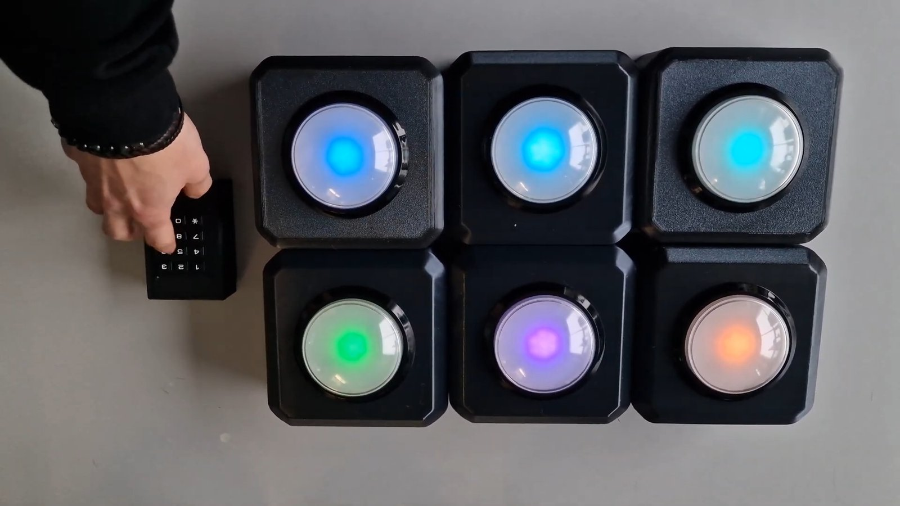
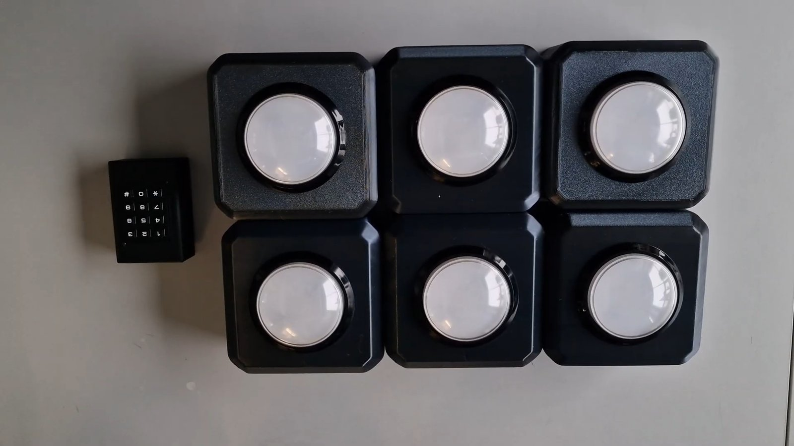
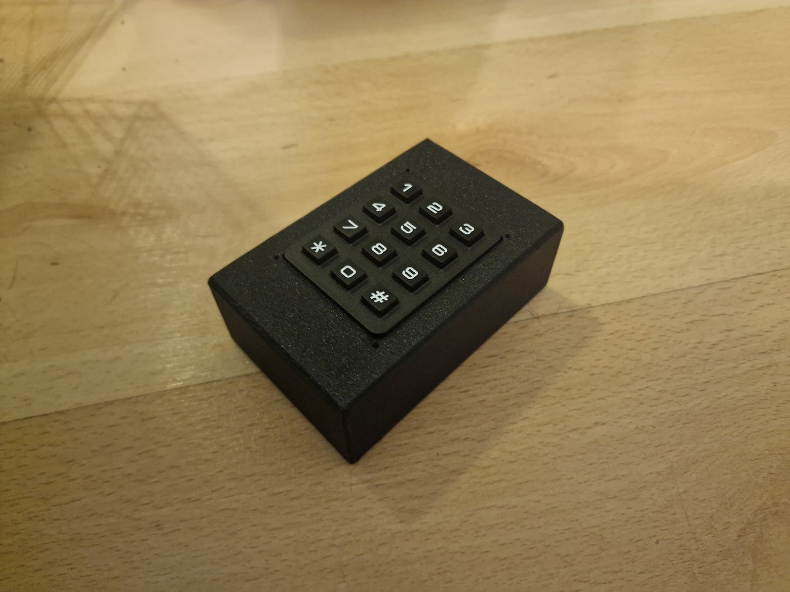

# Wireless reaction-training board (ESP32, ESP-NOW)

A set of battery-powered wireless buttons, a six-field switch board and a keypad remote
that together form a reaction-training game. All modules are ESP32 boards talking to each
other over ESP-NOW, with no router and no pairing step.

Built as a team project (project-based learning) at the Silesian University of Technology
and presented in January 2026. Polish version of the original notes: [README.pl.md](README.pl.md).

## What it does

- The **master remote** discovers every module in range, keeps track of which ones are
  alive, and runs the games from a 4x3 keypad.
- Each **button module** lights up in any RGB colour, beeps, and reports presses.
- The **board module** adds six more targets on one ESP32: six limit switches, each with
  its own RGB LED.
- Modules sleep when idle and wake on a button press, on a timer, or when the master
  calls them.

### Game modes

| Mode | How it works |
| --- | --- |
| Random target | One random module lights up. The player hits it, the next one lights up. Presses are counted. |
| Simon Says | The master shows a growing colour sequence on the modules and the player repeats it. Endless or a short 3-level variant. |
| All-press | Every module lights up in a random colour and the round ends when all of them have been pressed. |

## Hardware

| Module | Sketch | Main parts |
| --- | --- | --- |
| Master remote | `Pilot_Master/` | ESP32 board, 4x3 matrix keypad |
| Button (one per unit) | `przyciskSlave/` | ESP32 board, large push button, 7 NeoPixel LEDs, buzzer |
| Board | `planszaSlave/` | ESP32 board, 6 limit switches, 6 NeoPixel LEDs |

### Pin assignment

Master remote (`Pilot_Master/Pilot_Master.ino`):

| Signal | GPIO |
| --- | --- |
| Keypad rows 1-4 | 0, 1, 2, 4 |
| Keypad columns 1-3 | 5, 6, 7 |

Button module (`przyciskSlave/przyciskSlave.ino`):

| Signal | GPIO |
| --- | --- |
| Push button (active low, also the deep-sleep wake-up source) | 2 |
| Buzzer | 4 |
| NeoPixel data (7 LEDs) | 6 |
| On-board status LED | 10 |

Board module (`planszaSlave/planszaSlave.ino`):

| Signal | GPIO |
| --- | --- |
| Limit switches 1-6 (active low, pull-up) | 13, 12, 14, 27, 26, 33 |
| NeoPixel data (6 LEDs) | 15 |

Check the pins against your own wiring before flashing.

## Keypad commands

| Key | Action |
| --- | --- |
| 1 | Start the random-target game |
| 2 | Start Simon Says (endless) |
| 3 | Start Simon Says (3 levels) |
| 4 | Print the list of modules that are online |
| 5 | Start the all-press game |
| 7 | Put all modules into deep sleep |
| 8 | Wake modules (broadcast a wake-up call every 3 s) |
| 9 | Include or exclude the board module from the games |
| 0 | Reset the press counter |
| # | Stop the current game |

## Communication protocol

All modules use ESP-NOW on Wi-Fi channel 6. Messages are short ASCII strings. The master
sends most commands to the broadcast address, and each module reacts only to messages
carrying its own ID.

| Message | Direction | Meaning |
| --- | --- | --- |
| `ONLINE<id>` | module to master | Module announces itself after start-up or wake-up |
| `ONLINE_OK<id>` | master to module | Registration confirmed |
| `HEARTBEAT` | master to all | Sent every second so modules know the master is alive |
| `HB_ACK<id>` | module to master | Reply to the heartbeat; refreshes the module's "last seen" time |
| `START<id>` | master to module | It is this module's turn: light up and wait for a press |
| `ACK<id>` | module to master | `START` received |
| `BTN<id>` | module to master | The button or switch was pressed |
| `LED_ON<id>,<r>,<g>,<b>` | master to module | Light up in the given colour |
| `LED_ACK<id>` | module to master | `LED_ON` received |
| `LED_OFF` | master to all | Turn all LEDs off |
| `STOP` | master to all | End the current game |
| `SLEEP_NOW` | master to all | Go to deep sleep |
| `WAKE` | master to all | Stay awake and register |

Module IDs:

- Button modules derive their ID (1-99) from the last byte of their MAC address, so the
  same firmware image can be flashed to every unit without editing it.
- The board module uses six fixed IDs, 200-205, one per switch.

Reliability:

- Commands that matter (`START`, `LED_ON`) are confirmed. The master waits up to 1 s for
  the acknowledgement and retries up to 3 times.
- A module that does not answer is removed from the list of active modules and the game
  continues with the remaining ones.
- The master treats a module as offline after 60 s of silence. A module treats the master
  as gone after 45 s without a heartbeat.

## Power saving

- Button modules run the LEDs at reduced brightness and use Wi-Fi modem sleep.
- On `SLEEP_NOW` a module enters deep sleep. It wakes on a button press or every 30 s,
  listens for a `WAKE` call for 8 s, and goes back to sleep if nobody calls.
- The master remote goes to sleep after 30 s without activity (no game running, wake-up
  broadcast switched off) and wakes on a key in the 7-8-9 row.

## Building

The sketches are written for the Arduino IDE with the ESP32 board package.

Libraries:

- `Adafruit NeoPixel` (button and board modules)
- `Keypad` (master remote)

Open the folder of the module you want to build, select your ESP32 board and flash it.
All modules must use the same ESP-NOW channel (`KANAL_WIFI_ESPNOW`).

## Known limitations

- ESP-NOW traffic is not encrypted.
- The message format is defined separately in each sketch instead of a shared header.
- Two button modules can end up with the same ID if the last bytes of their MAC addresses
  collide.
- There are no automated tests.

## Team and roles

This was a team project. This repository contains the firmware.

- Krzysztof Billik: firmware for all three modules, electronics design together with a teammate.
- Enclosures were designed by another team member.
